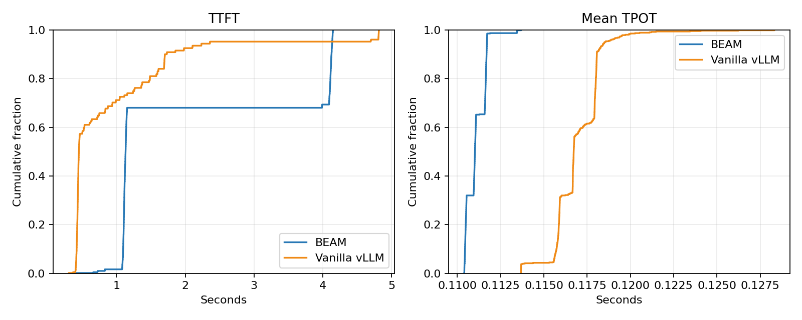
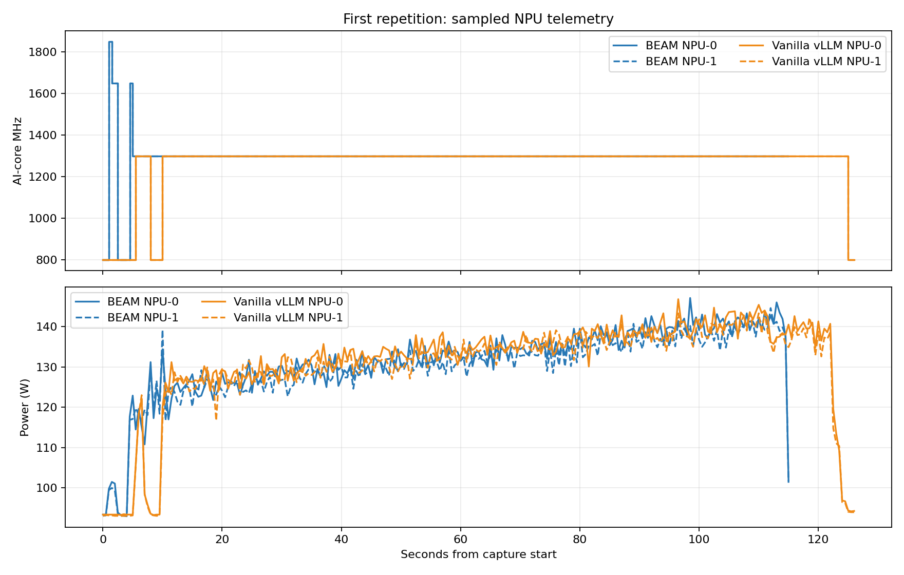
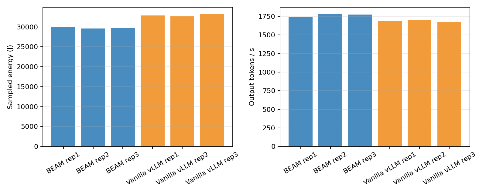

# Decode Heavy Cap200 Clock1300

## Workload and setup

- Model: Qwen3-8B, vLLM 0.23.0, tensor parallelism 2 on NPU 0 and 1.
- Workload shape follows `experiments/req-shape-1.json`; synthetic prompts use the configured exact token counts.
- Synthetic request shape: 1 input tokens, 1000 output tokens; 200 offered requests per repetition.
- Server and client in-flight cap: 200.
- Vanilla vLLM fixed AI-core clock: 1300 MHz.
- BEAM configured TTFT/TBT SLOs: 0.600/0.400 s.
- BEAM S1/S2 used `tests/beam_wide_profile.py`'s synthetic profile; this was not calibrated for Qwen3-8B or TP2.
- Read-only DSMI frequency and whole-device power samples were collected every 0.5 s for each NPU.
- Sampled energy is trapezoidal integration of whole-device power; it includes idle/system power and is not an NPU energy-counter reading.
- Warm-up traffic is retained under each backend's `warmup/` folder and excluded from the three measured repetitions.

The existing `experiments/benchmarks.json` does not expand: its lane sweeps omit the required `max_num_batched_tokens`. `experiments/azure_mix.py` was not run because `/data1/datasets/azure-mix/scheduled_prompts.csv` is absent.

## Results

| Backend | Rep | Completed/200 | Shape valid | Mean TTFT (s) | P95 TTFT (s) | Mean TPOT (s) | P95 TPOT (s) | Output tok/s | NPU energy (J) | Mean MHz NPU0/1 |
|---|---:|---:|:---:|---:|---:|---:|---:|---:|---:|---:|
| beam | rep1 | 200/200 | True | 3.978 | 4.144 | 0.111 | 0.111 | 1745.354 | 30056.2 | 1294/1294 |
| beam | rep2 | 200/200 | True | 1.120 | 1.151 | 0.111 | 0.111 | 1783.500 | 29631.4 | 1295/1295 |
| beam | rep3 | 200/200 | True | 1.112 | 1.144 | 0.112 | 0.112 | 1773.490 | 29747.4 | 1298/1298 |
| vllm | rep1 | 200/200 | True | 1.231 | 4.813 | 0.117 | 0.118 | 1688.334 | 32864.9 | 1264/1264 |
| vllm | rep2 | 200/200 | True | 0.853 | 2.113 | 0.116 | 0.118 | 1696.429 | 32657.4 | 1274/1274 |
| vllm | rep3 | 200/200 | True | 0.808 | 1.699 | 0.118 | 0.119 | 1672.420 | 33253.7 | 1269/1269 |

## Interpretation and limitations

- Compare measured TTFT/TPOT, throughput, sampled clocks, and integrated device power; BEAM's profile-estimated energy is not a measured value.
- The decode control uses the requested 1300 MHz. BEAM chooses clocks according to its scheduler and synthetic profile; the observed per-device samples show what was actually applied.
- Idle and boundary samples may show 800 MHz; the vanilla target clock is observed during active work.
- TPOT is the request client's mean inter-content-chunk gap. It is not a hardware token-event counter.
- Repetitions are reported separately; first-run effects and run-to-run variability are retained rather than discarded.
- Inspect the saved request JSON/CSV and NPU sample CSVs for errors, token-shape validity, sampling gaps, and variability before drawing conclusions.

## Plots

