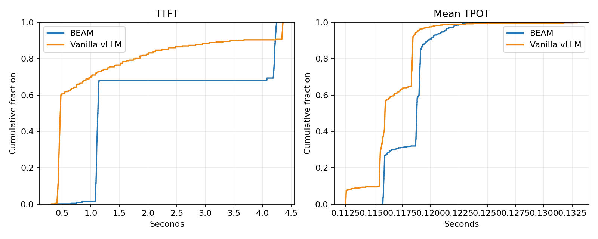
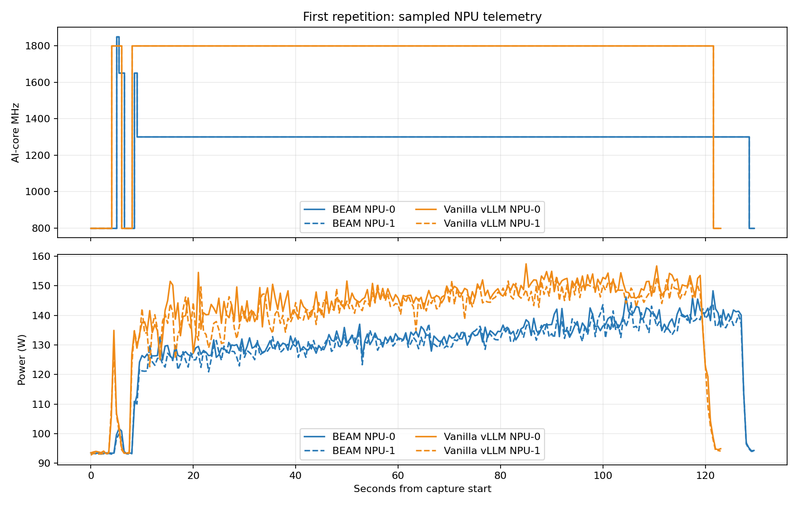
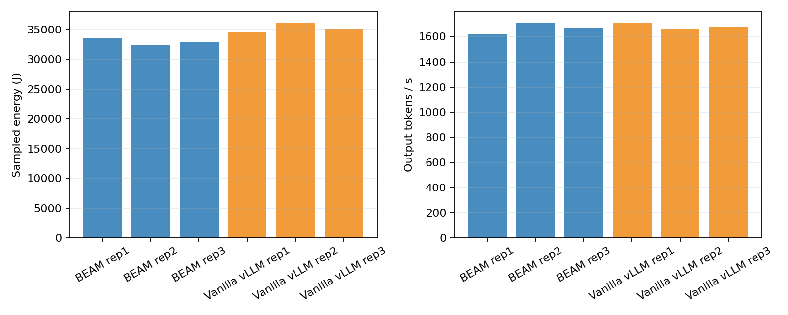

# Decode Heavy Cap200

## Workload and setup

- Model: Qwen3-8B, vLLM 0.23.0, tensor parallelism 2 on NPU 0 and 1.
- Workload shape follows `experiments/req-shape-1.json`; synthetic prompts use the configured exact token counts.
- Synthetic request shape: 1 input tokens, 1000 output tokens; 200 offered requests per repetition.
- Server and client in-flight cap: 200.
- Vanilla vLLM clock policy: host default dynamic DVFS without a static clock lock; rated clock 1800 MHz, expected 800 MHz idle and up to 1800 MHz under load.
- BEAM configured TTFT/TBT SLOs: 0.600/0.400 s.
- BEAM S1/S2 used `tests/beam_wide_profile.py`'s synthetic profile; this was not calibrated for Qwen3-8B or TP2.
- Read-only DSMI frequency and whole-device power samples were collected every 0.5 s for each NPU.
- Sampled energy is trapezoidal integration of whole-device power; it includes idle/system power and is not an NPU energy-counter reading.
- Both NPUs were explicitly reset to rated 1800 MHz before and after each backend session; each reset verified 800 MHz at idle. Vanilla vLLM ran without a static clock lock.
- Every vanilla repetition sampled both 800 MHz idle and 1800 MHz loaded on NPUs 0 and 1.
- Warm-up traffic is retained under each backend's `warmup/` folder and excluded from the three measured repetitions.
- All BEAM requests completed, but its container required a forced stop (exit 137); the subsequent explicit clock reset succeeded and verified both devices at 800 MHz idle (`beam/clock_reset_after.log`).

The existing `experiments/benchmarks.json` does not expand: its lane sweeps omit the required `max_num_batched_tokens`. `experiments/azure_mix.py` was not run because `/data1/datasets/azure-mix/scheduled_prompts.csv` is absent.

## Results

| Backend | Rep | Completed/200 | Shape valid | Mean TTFT (s) | P95 TTFT (s) | Mean TPOT (s) | P95 TPOT (s) | Output tok/s | NPU energy (J) | Mean MHz NPU0/1 |
|---|---:|---:|:---:|---:|---:|---:|---:|---:|---:|---:|
| beam | rep1 | 200/200 | True | 4.069 | 4.239 | 0.120 | 0.122 | 1622.732 | 33596.5 | 1273/1273 |
| beam | rep2 | 200/200 | True | 1.109 | 1.139 | 0.116 | 0.118 | 1709.703 | 32416.0 | 1276/1276 |
| beam | rep3 | 200/200 | True | 1.107 | 1.136 | 0.119 | 0.121 | 1668.712 | 32932.3 | 1283/1283 |
| vllm | rep1 | 200/200 | True | 1.617 | 4.351 | 0.115 | 0.117 | 1711.661 | 34617.9 | 1735/1735 |
| vllm | rep2 | 200/200 | True | 0.745 | 1.861 | 0.119 | 0.120 | 1662.223 | 36171.0 | 1724/1724 |
| vllm | rep3 | 200/200 | True | 1.086 | 3.067 | 0.116 | 0.118 | 1679.738 | 35166.0 | 1752/1752 |

## Interpretation and limitations

- Compare measured TTFT/TPOT, throughput, sampled clocks, and integrated device power; BEAM's profile-estimated energy is not a measured value.
- The requested 1300 MHz applies only to BEAM's synthetic-profile policy. Vanilla was intentionally run without a static clock lock at the host-default dynamic setting, rated at 1800 MHz.
- Confirm the expected 800 MHz idle and 1800 MHz loaded clocks from the raw per-device telemetry; idle and boundary samples can lower the reported mean.
- TPOT is the request client's mean inter-content-chunk gap. It is not a hardware token-event counter.
- Repetitions are reported separately; first-run effects and run-to-run variability are retained rather than discarded.
- Inspect the saved request JSON/CSV and NPU sample CSVs for errors, token-shape validity, sampling gaps, and variability before drawing conclusions.

## Plots

