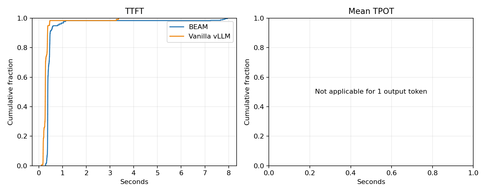
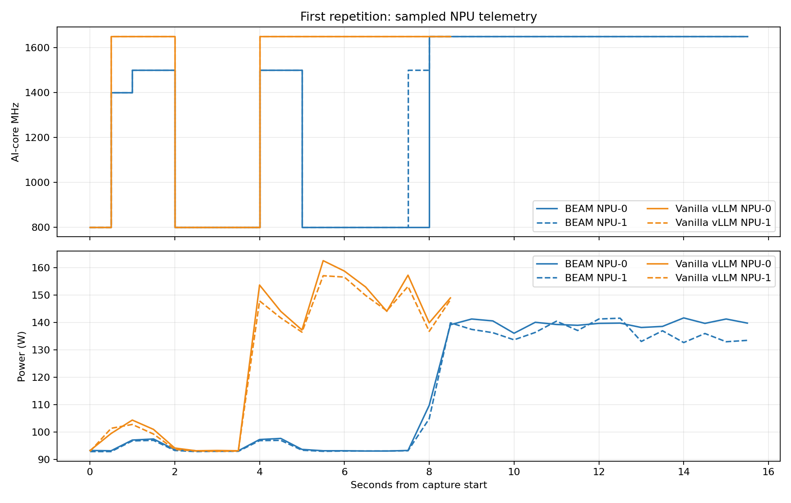
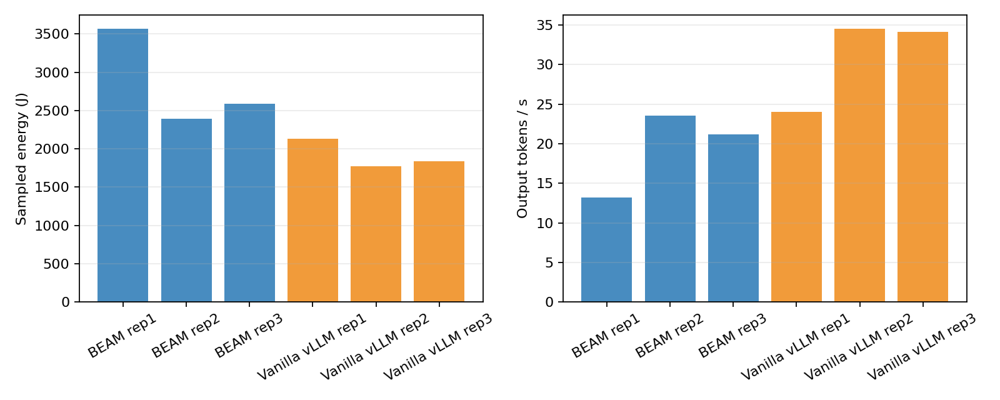

# Prefill Heavy Cap10 Clock1650

## Workload and setup

- Model: Qwen3-8B, vLLM 0.23.0, tensor parallelism 2 on NPU 0 and 1.
- Workload shape follows `experiments/req-shape-1.json`; synthetic prompts use the configured exact token counts.
- Synthetic request shape: 1000 input tokens, 1 output tokens; 200 offered requests per repetition.
- Server and client in-flight cap: 10.
- Vanilla vLLM fixed AI-core clock: 1650 MHz.
- BEAM configured TTFT/TBT SLOs: 0.600/0.120 s.
- BEAM S1/S2 used `tests/beam_wide_profile.py`'s synthetic profile; this was not calibrated for Qwen3-8B or TP2.
- Read-only DSMI frequency and whole-device power samples were collected every 0.5 s for each NPU.
- Sampled energy is trapezoidal integration of whole-device power; it includes idle/system power and is not an NPU energy-counter reading.
- Warm-up traffic is retained under each backend's `warmup/` folder and excluded from the three measured repetitions.

The existing `experiments/benchmarks.json` does not expand: its lane sweeps omit the required `max_num_batched_tokens`. `experiments/azure_mix.py` was not run because `/data1/datasets/azure-mix/scheduled_prompts.csv` is absent.

## Results

| Backend | Rep | Completed/200 | Shape valid | Mean TTFT (s) | P95 TTFT (s) | Mean TPOT (s) | P95 TPOT (s) | Output tok/s | NPU energy (J) | Mean MHz NPU0/1 |
|---|---:|---:|:---:|---:|---:|---:|---:|---:|---:|---:|
| beam | rep1 | 200/200 | True | 0.750 | 1.115 | n/a | n/a | 13.186 | 3570.3 | 1331/1353 |
| beam | rep2 | 200/200 | True | 0.416 | 0.571 | n/a | n/a | 23.538 | 2392.7 | 1589/1589 |
| beam | rep3 | 200/200 | True | 0.460 | 0.619 | n/a | n/a | 21.175 | 2585.8 | 1586/1586 |
| vllm | rep1 | 200/200 | True | 0.410 | 0.611 | n/a | n/a | 23.994 | 2135.0 | 1414/1414 |
| vllm | rep2 | 200/200 | True | 0.282 | 0.382 | n/a | n/a | 34.531 | 1770.3 | 1650/1650 |
| vllm | rep3 | 200/200 | True | 0.289 | 0.373 | n/a | n/a | 34.115 | 1837.3 | 1650/1650 |

## Interpretation and limitations

- Compare measured TTFT/TPOT, throughput, sampled clocks, and integrated device power; BEAM's profile-estimated energy is not a measured value.
- The requested prefill point of 1700 MHz is outside the checked-in BEAM NPU clock catalog (900–1650 MHz), so the vanilla control uses 1650 MHz, the nearest supported lower setting.
- Idle and boundary samples may show 800 MHz; the vanilla target clock is observed during active work.
- TPOT is the request client's mean inter-content-chunk gap. It is not a hardware token-event counter.
- Repetitions are reported separately; first-run effects and run-to-run variability are retained rather than discarded.
- Inspect the saved request JSON/CSV and NPU sample CSVs for errors, token-shape validity, sampling gaps, and variability before drawing conclusions.

## Plots

